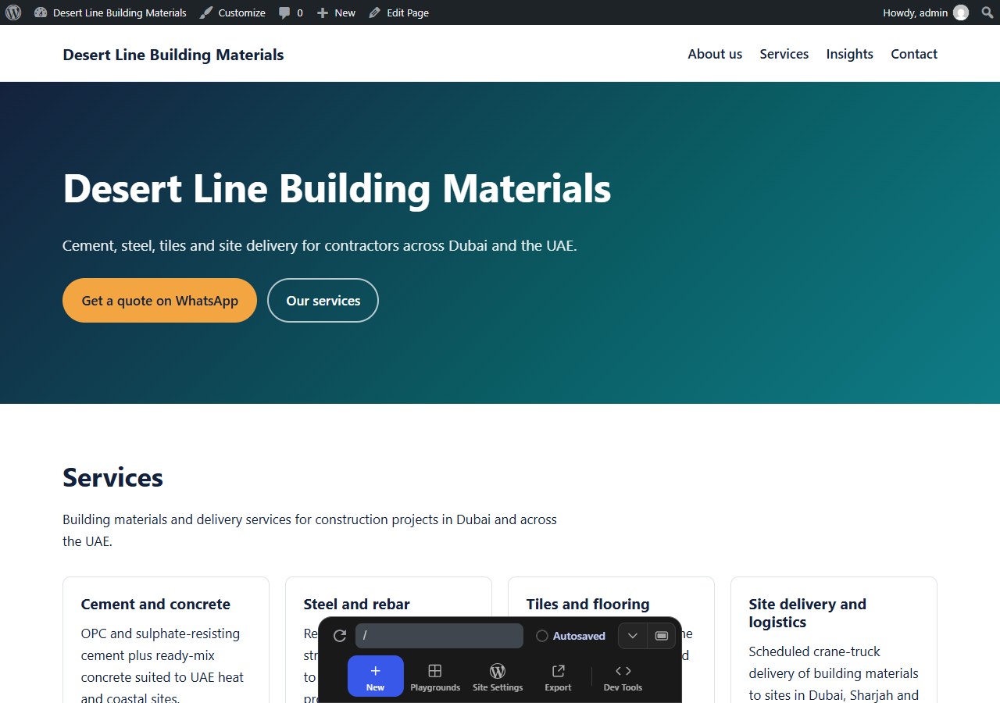

# Marina Business — SEO-ready WordPress theme

A fast, lightweight WordPress theme for UAE businesses, with technical SEO built in.

**Live demo:** [Open in WordPress Playground](https://playground.wordpress.net/?blueprint-url=https://raw.githubusercontent.com/Stuart-Vision/marina-business-theme/main/blueprint.json) — runs a full WordPress site in your browser with demo content for a fictional Dubai building-materials trader. Admin login: `admin` / `password`.



## Why this theme

Many business sites load heavy page builders and three SEO plugins, then struggle with Core Web Vitals. Marina keeps the front end small and puts the SEO basics directly into the theme:

| Area | What the theme does |
| --- | --- |
| Schema markup | One JSON-LD `@graph` per page: `WebSite` with `SearchAction`, `LocalBusiness` (or a more specific type such as `HomeAndConstructionBusiness`), `BreadcrumbList` on inner pages, `BlogPosting` on articles |
| On-page SEO | Meta descriptions from the excerpt (or content), canonical URLs for the home page and archives, Open Graph and Twitter card tags |
| Indexing | `noindex, follow` on date, author and 404 pages through the core `wp_robots` filter; WordPress core already handles search results and the XML sitemap (`/wp-sitemap.xml`) |
| Local SEO | Business name, address and phone (NAP) entered once in the Customizer and reused in the footer and the schema; WhatsApp click-to-chat call to action |
| Breadcrumbs | Visible breadcrumbs built from the same data as the `BreadcrumbList` schema, so the two never disagree |
| Plugin friendly | All meta tags and schema switch off automatically when **Yoast SEO** or **Rank Math** is active, so pages never print duplicate tags |
| Performance | No jQuery, no web fonts, one small deferred script; emoji script and unused head tags removed; block-library CSS skipped on pages without blocks; first image loaded with `fetchpriority="high"` |
| Accessibility | Skip link, semantic landmarks, keyboard-friendly mobile menu (Escape closes it), visible focus styles, `prefers-reduced-motion` support |

## Structure

```
marina/
├── style.css             Theme header and all styles (mobile-first, CSS variables)
├── functions.php         Theme supports, menus, asset loading
├── inc/
│   ├── seo.php           Meta tags, canonical, robots, JSON-LD schema
│   ├── customizer.php    Business details (NAP, hours, WhatsApp)
│   ├── template-tags.php Breadcrumbs and contact helpers
│   └── performance.php   Front-end clean-up for Core Web Vitals
├── front-page.php        Hero, services grid, latest articles
├── page.php / single.php / index.php / search.php / 404.php
├── template-parts/card.php
└── assets/navigation.js  Mobile menu toggle (no jQuery)
playground/
├── demo-content.php      Demo pages, posts, menus and business details
└── blueprint.local.json  Blueprint for running the theme from a local folder
blueprint.json            Blueprint for the live demo (installs the theme from GitHub)
```

## Install

1. Download this repository and copy the `marina` folder to `wp-content/themes/`.
2. Activate **Marina Business** under *Appearance → Themes*.
3. Fill in *Appearance → Customize → Business details*.
4. Create a page with the slug `services`; its child pages appear as the services grid on the home page.

### Run locally with WordPress Playground

```bash
npx @wp-playground/cli server --mount=./marina:/wordpress/wp-content/themes/marina --blueprint=./playground/blueprint.local.json
```

## Checking the SEO output

- Google Rich Results Test: paste any page URL to validate the schema.
- View source and search for `application/ld+json` and `<!-- Marina SEO -->`.
- `/wp-sitemap.xml` lists all public pages and posts.

## License

GPL-2.0-or-later, like WordPress itself.
